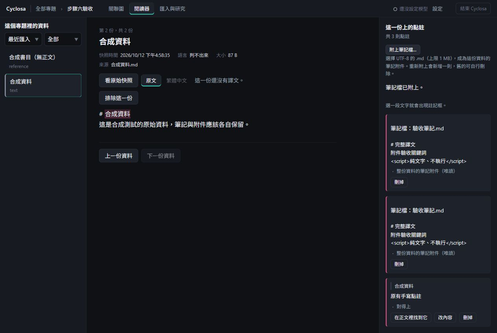
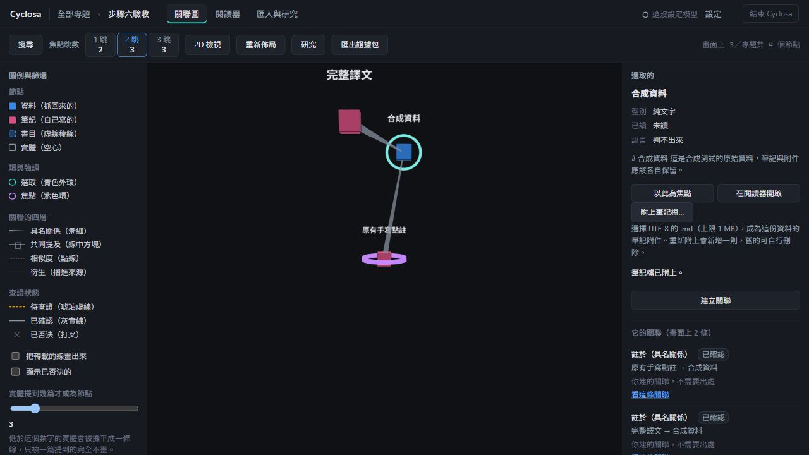

# Issue 3：筆記附件驗收

以下畫面只使用合成資料，未呼叫模型。

## 閱讀器

同一檔案重新附上會新增一則；附件標示原檔名、置頂、顯示純文字且只有刪除入口。原有手寫點註保留編輯與定位操作。

## 關聯圖與節點面板

選取來源資料後，節點面板提供附檔入口；筆記透過人工已確認的「註於」關聯連回來源。關聯詳情由側欄「看這條關聯」開啟。

## 驗證

- 本機 Verify.ps1 全綠：126 個測試檔、1468 項測試。
- 使用者回報完整人工驗收結果符合預期：手寫點註、閱讀器與圖上附檔、重附、搜尋、取消與確認刪除、重新整理、無正文書目、格式／編碼／大小錯誤、BOM、重算、一般匯入及重啟保存。
- 邊界測試涵蓋剛好 1 MB、空白檔案、筆記不可再附筆記，以及刪除不影響原始檔。
- 畫面是本機驗收時保留的合成資料截圖；人工驗收由使用者實際操作，未以 API 測試冒充完整手動操作。