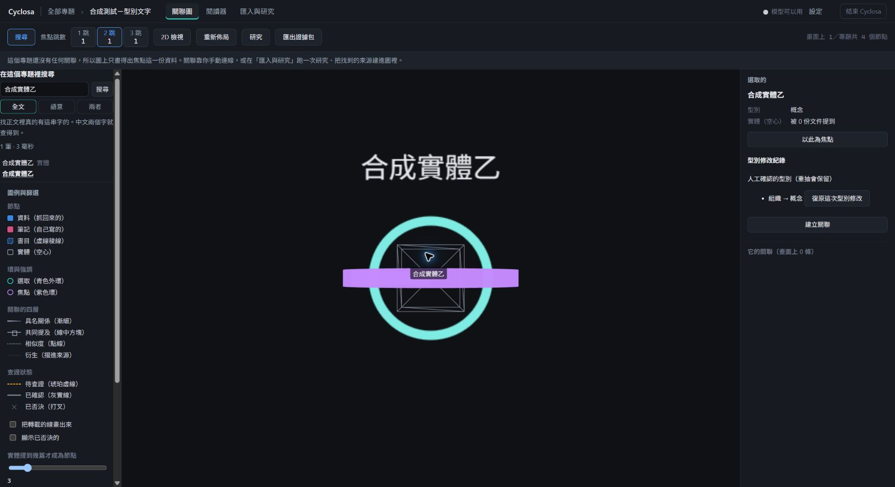
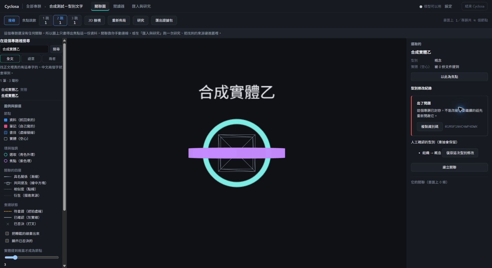
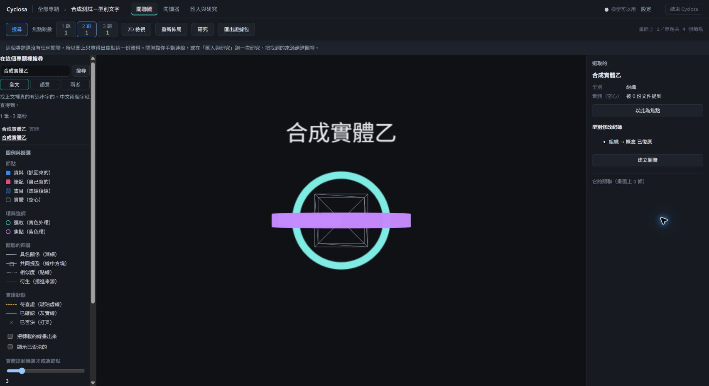

# Issue #6：實體型別修改驗收

## 範圍

整理操作 `retype {entityId, to}`：人勾選後修改型別、保留紀錄、可從實體面板復原。
本次沒有執行合併實體操作。畫面中的測試專題與實體名稱沿用既有開發工具產生的虛構資料，不代表合併。
不更動抽取可用的型別清單，也不以本次驗收宣稱真實模型的提案品質。

## 自動驗證

完整 `tools/Verify.ps1` 與建置通過。測試涵蓋：

- 預設不勾，單獨改型別不用抽取模型；修改與復原舊值在同一交易保存。
- 人工改型別後呼叫真正的共用 `applyExtraction`，模型回舊型別、其他型別與別名仍保留人工決定，不另建同名節點。
- 同名但有明確異型別身分的另一實體，不被人工保護錯誤吸收。
- 連續修改依序退；重複或過期的復原請求失效，退一層恢復原人工標記。
- 勾選後人工決定變更，舊提案標 stale；單條失效不阻止其他提案。
- v14 升 v15 保留既有實體、預設人工標記 0，值域約束拒絕非法標記。
- 孤立實體清理保留人工型別，普通孤立實體仍清理，舊 schema 升級測試仍通過。
- 合併人工實體後重抽對回保留者；取消合併後對回原人工實體。
- 封存拒絕勾選、執行與復原；等待服務檢查期間封存、取消勾選或放棄，皆不建立作業。
- 並行重複送出只有一個請求成功開作業。
- 同批改型別與抽取走共用 worker，兩項成功，只呼叫一次抽取模型。
- 寫入紀錄失敗整次交易回滾。

人工保護守門以刻意停用保護驗證會失敗，再恢復驗證通過；同名異型別邊界亦先以測試重現失敗再修正。
模型回傳使用虛構結果或假的 Ollama，不需要私人端點或實際模型。

## Chrome 真實 App 驗收

重開修正版後，以虛構專題進行：

1. 所有建議預設未勾，只勾「改實體型別」。唯讀檢查確認 `expectedRevision` 已保存，證實新後端已載入。
2. 只改「組織 → 概念」：畫面成功 1、失敗 0，模型呼叫 0 次，兩條未勾抽取未執行。
3. 圖上選取實體，側欄顯示概念、人工確認提示、修改紀錄及復原按鈕。
4. 在另一分頁封存專題，再由舊畫面按復原；後端拒絕，畫面提示「這個專題已封存，不能改動」。
5. 從清單重新開啟專題，原修改可以正常復原為組織；紀錄保留「已復原」，復原按鈕消失。
6. 唯讀檢查確認 `type='org'`、`type_manual=0`、`undoneAt` 已保存，兩條抽取仍未勾且待執行。專題已恢復開啟。

前一輪亦已確認重新整理後人工修改與紀錄保留。本輪新增並行情況與重抽保護仍以自動測試驗證，未混稱為 Chrome 實測。

### 修改成功

### 封存後擋住舊請求

### 重新開啟後復原

## 限制

- 真實模型的型別修改提案品質未量測；本次驗收的是人確認後的執行與保護。
- 孤立實體的搜尋結果仍只定位，驗收由圖上點選進入實體面板；搜尋直接選取的修正屬 PR #15，不是本次範圍。
- 整理完整操作 schema 與 `anyOf` 支援沿用 PR #15 相同修正，因為型別提案也需要完整參數。
- 原 `data-model-1.svg` 過期與前端產物大小提醒不阻擋 Verify 或建置，未改動產生物。
