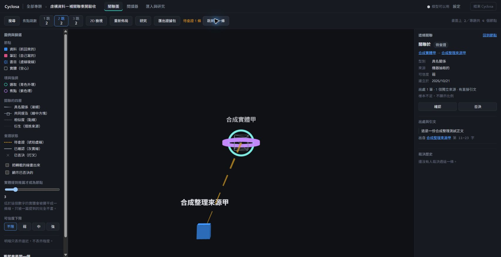

# Issue #7 驗收紀錄

## 已執行

- 完整 Verify.ps1 通過：132 個測試檔、1,542 項測試，以及程式風格、伺服器及測試型別、前端型別與守門。
- 完整建置：伺服器與前端成功。
- 13 項新增測試涵蓋：引文定位成功／失敗、同來源墓碑阻擋、新來源墓碑例外、來源排除與刪除、規劃丟棄無效引文、純補關聯零模型呼叫、部分失敗、新關聯復原與端點保留、既有關聯補出處復原、重複復原、人工變更保護、跨作業補出處保護。
- Chrome 擴充套件：在新建虛構專題套用既有開發範例，只勾「補關聯」，結果成功 1、失敗 0、新增關聯 1、模型呼叫 0。
- 關聯圖：新關聯顯示具名關係、待查證、弱可信度、出處 1 筆／1 個獨立來源、直接引文與第 11–23 字。
- 實測發現執行按鈕仍寫「抽取」，已改為「操作」。

## 復原與重開補驗

- 使用者完成復原確認後已核對：測試專題剩 0 條關聯，2 份資料及被用作端點的實體保留。另一個未參與關聯的孤立範例實體由既有復原清理規則刪除。
- 使用者重啟後，於另一個空測試專題套用既有開發範例，補關聯再次成功：新增關聯 1、模型呼叫 0；按鈕已顯示「執行已勾選的操作」。唯讀核對確認新關聯的前後快照已寫入，最新後端已載入。跨作業變更保護由自動測試驗證。
- 系統 Node.js 升級至 24.22.1 後，收尾重新執行完整檢查與建置；結果見 PR 驗證欄。

## 測試邊界

引文失敗、墓碑、跨作業變更等情境由自動測試驗證，不宣稱都經人工畫面實測。混合抽取／補關聯、封存與並行請求仍可擴充專門情境；通過測試不代表不存在其他問題。使用獨立 issue7 副本，不帶入 issue5／issue6 尚未合併的程式與資料。

畫面使用虛構資料；其中「合成」名稱來自既有開發範例，並非「合併」操作。此次新建專題名稱使用「虛構資料」。截圖見下方的虛構資料驗收畫面。

## 畫面操作紀錄

1. 在「虛構資料－補關聯驗收」的整理作業按「復原這次作業」並確認。
2. 已核對刪除本次關聯，兩份匯入資料與關聯端點保留。
3. 重開首頁顯示原測試專題關聯 0、資料 2、實體 1，與唯讀核對一致。
4. 使用者正常重開後已補查按鈕名稱與執行結果，第二個測試專題保留 1 條未裁決關聯供檢視。

